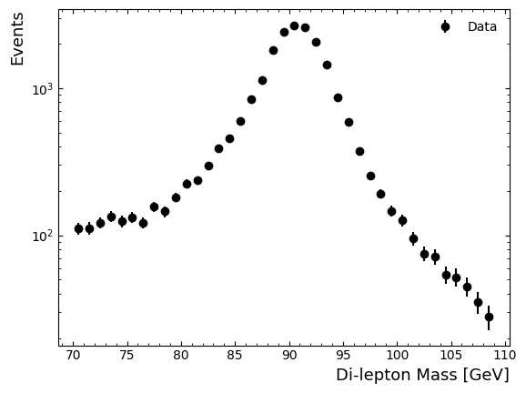

# 学习笔记：Find the Z boson（暗物质课题热身）

> 整理自与 Claude 的交流，日期 2026-11-01。
> 对应文件：[Find-the-Z-boson任务要求.md](Find-the-Z-boson任务要求.md)、[Find_the_Z_ipynb.ipynb](Find_the_Z_ipynb.ipynb)
> 公式均为 LaTeX，建议用支持数学公式的 Markdown 阅读器打开，如 VS Code 预览、Typora、Obsidian。

---

## 交流记录

**我的提问：**
> 核物理系暗物质课题学习组的任务，请先不要实操，先通读内容，并教我（物理系大二，没有核物理基础）。

**Claude 的讲解**整理在下面第 0–7 节。

**我的后续请求：**
> 把我们的交流、你的教授存在本地 md 里，方便我研读。公式用 latex 写。

---

## 0. 这个任务在干什么

用 ATLAS 实验 2015–2016 年的真实对撞数据，**自己"重建"出 Z 玻色子**。Z 寿命极短，探测器看不到它本身，只能看到它衰变出来的两个 μ 子。把两个 μ 子的能量和动量合起来算一个"不变质量"，在 $91\ \text{GeV}$ 附近会冒出一个峰，这个峰就是 Z。

这是暗物质课题的热身。暗物质搜寻的基本功也是这一套：从末态粒子出发，设计筛选条件，画分布，再和模拟比较。

老师的要求可以拆成 4 件事：

1. 在 Colab 里从上到下跑通 notebook，先用默认数据量；
2. **理解**四个概念：末态粒子、事件筛选、不变质量、数据与模拟；
3. **至少改一个筛选条件**（比如 μ 子横动量阈值），对比改前改后的质量分布，并解释变化；
4. 写一份报告。

---

## 1. 必备背景（零基础版）

### 1.1 标准模型和 Z 玻色子

- 物质由夸克和轻子组成。轻子包括 $e$、$\mu$、$\tau$，以及对应的三种中微子 $\nu_e,\nu_\mu,\nu_\tau$。
- 相互作用靠玻色子传递：光子 $\gamma$（电磁）、$W^\pm/Z$（弱相互作用）、胶子 $g$（强相互作用）。
- **Z 玻色子**：电中性，
  $$m_Z \approx 91.19\ \text{GeV},\qquad \Gamma_Z \approx 2.50\ \text{GeV}$$
  寿命由不确定关系给出：
  $$\tau = \frac{\hbar}{\Gamma_Z} \approx \frac{6.58\times10^{-25}\ \text{GeV·s}}{2.50\ \text{GeV}} \approx 3\times10^{-25}\ \text{s}$$
  notebook 里写的是 "$10^{25}$ seconds"，漏了负号，应为 $10^{-25}$。
- 寿命越短，质量越"不确定"，所以质量分布是一个有宽度的峰，不是一条细线。峰的形状是 Breit–Wigner 分布：
  $$f(M) \propto \frac{1}{(M^2 - m_Z^2)^2 + m_Z^2\Gamma_Z^2}$$

### 1.2 LHC 与 ATLAS

- LHC 让两束质子以 $\sqrt{s} = 13\ \text{TeV}$ 对撞。真正参与碰撞的是质子里的夸克或胶子，比如
  $$q\bar q \to Z \to \mu^+\mu^-$$
- ATLAS 是一个洋葱式结构的探测器，由内到外依次是：径迹室（测带电粒子的轨迹和动量）、电磁量能器（吸收 $e$、$\gamma$）、强子量能器（吸收强子），最外层是 **μ 子谱仪**。
- μ 子能穿透整个探测器，信号干净、本底少，所以这个 notebook 选双 μ 子末态（`skim = '2muons'`）。

### 1.3 坐标和运动学量（数据里存的 4 个量）

$z$ 轴沿着束流方向。

| 变量 | 定义 | 为什么用它 |
|---|---|---|
| `lep_pt` | $p_T = \sqrt{p_x^2 + p_y^2}$，横动量 | 对撞前横向总动量 $\approx 0$，但参与碰撞的夸克带了多少纵向动量未知，所以横向量最可靠 |
| `lep_eta` | $\eta = -\ln\tan(\theta/2)$，赝快度 | $\eta=0$ 垂直于束流，$\lvert\eta\rvert$ 越大越靠近束流。粒子在 $\eta$ 上大致均匀分布，而且 $\Delta\eta$ 在沿 $z$ 的洛伦兹变换下不变 |
| `lep_phi` | $\phi$，$x$-$y$ 平面内的方位角 | |
| `lep_e` | $E$，能量 | |

由这 4 个量还原出四动量 $(E, p_x, p_y, p_z)$：
$$p_x = p_T\cos\phi,\qquad p_y = p_T\sin\phi,\qquad p_z = p_T\sinh\eta,\qquad |\vec p| = p_T\cosh\eta$$

单位用**自然单位**：$c = 1$，能量、动量、质量都用 GeV。恢复 $c$ 时，质能关系写作
$$(Mc^2)^2 = E^2 - (|\vec p|c)^2$$
粒子静止时 $\vec p = 0$，就回到 $E = Mc^2$。

---

## 2. 老师点名的四个核心概念

### ① 末态粒子（final state）

探测器最终"看到"的、寿命足够长的粒子：$e$、$\mu$、$\gamma$、强子簇射形成的喷注（jet），以及间接推断出来的"丢失能量"（中微子）。这里的末态是**两个 μ 子**：
$$pp \to Z + X \to \mu^+\mu^- + X$$

注意：`2muons` skim 是官方预先做好的筛选，你拿到的数据从一开始就已经被筛过一次了。notebook 注释说它保留"恰好两个 μ 子"的事件，但真实数据里是**至少两个 μ 子**（98.9% 恰好两个），`lep_*` 数组里还混有电子（详见 [报告准备](report/报告准备.md) 第 2.1 节）。

### ② 不变质量（invariant mass）

四动量 $p^\mu = (E, \vec p)$，闵可夫斯基"长度"的平方就是质量的平方：
$$p^\mu p_\mu = E^2 - |\vec p|^2 = m^2$$

两个粒子的四动量相加后取长度：
$$M_{\ell\ell}^2 = (p_1 + p_2)^\mu (p_1 + p_2)_\mu = (E_1 + E_2)^2 - |\vec p_1 + \vec p_2|^2$$

- 叫"不变"，是因为 $p^\mu p_\mu$ 是洛伦兹标量，在任何参考系里都相同。Z 无论以什么速度飞，算出来都是 Z 的质量。
- 如果两个 μ 真来自 Z（四动量守恒 $p_Z = p_1 + p_2$），$M_{\ell\ell}$ 就落在 $m_Z$ 附近；如果只是两个随机的 μ，$M_{\ell\ell}$ 会散布在一大片范围里。
- 用 $(p_T,\eta,\phi)$ 表示，在忽略轻子质量（$m_\mu \approx 0.106\ \text{GeV} \ll p_T$）时：
  $$\boxed{M_{\ell\ell}^2 \approx 2\,p_{T1}\,p_{T2}\left[\cosh(\eta_1 - \eta_2) - \cos(\phi_1 - \phi_2)\right]}$$
  讨论 $p_T$ 阈值时会用到这个式子。

#### 手算题答案（notebook cell-23，单位 MeV）

**第 1 题：不变质量**

$$E = 147913 + 21272 = 169185\ \text{MeV}$$
$$p_x = 32387 - 18772 = 13615,\quad p_y = 7047 - 9563 = -2516,\quad p_z = 144152 - 2942 = 141210\ \ (\text{MeV})$$
$$M = \sqrt{E^2 - p_x^2 - p_y^2 - p_z^2} \approx 92150\ \text{MeV} \approx \mathbf{92.1\ GeV}$$

结果正好在 Z 附近。

> 自检：单个轻子算出的 $E_i^2 - |\vec p_i|^2$ 接近 0（$\ll E_i^2$）。题目数值四舍五入到 MeV，所以分辨不出 μ 子的 $0.106\ \text{GeV}$ 质量，但能确认轻子是"近似无质量"的。

**第 2 题：若 lep[0] 是电子，洛伦兹因子**

$$\gamma = \frac{E}{m} = \frac{147913\ \text{MeV}}{0.5\ \text{MeV}} \approx 3.0\times10^{5}$$

**第 3 题：总动量大小**

$$|\vec p_0| = \sqrt{32387^2 + 7047^2 + 144152^2} \approx 147913\ \text{MeV} \approx 147.9\ \text{GeV}$$

几乎等于 $E$，说明粒子是极端相对论性的。

**第 4 题：速度**

由 $p = \gamma m v$，得 $\beta = v/c = p/E$。$\gamma \gg 1$ 时
$$1 - \beta \approx \frac{1}{2\gamma^2} \approx 6\times10^{-12}$$

用牛顿式 $p = mv$ 计算时，$v \le c$ 意味着 $p \le mc \approx 0.5\ \text{MeV}$，比实际动量小 30 万倍。这就是必须用相对论的原因。

### ③ 事件筛选（event selection / cuts）

对每个碰撞事件提出条件，只保留满足条件的。目的是**提高信号占比、压低本底**。常见条件：

- 轻子横动量阈值 $p_T > p_T^{\text{cut}}$：来自 Z 的 μ 子，在 Z 静止系里每个的动量约为 $m_Z/2 \approx 45.6\ \text{GeV}$；
- 电荷相反 $q_1 q_2 < 0$：Z 是中性的，衰变成 $\mu^+\mu^-$；
- 孤立性：轻子周围没有一堆别的粒子。来自喷注里重味夸克衰变的 μ 子通常不孤立；
- 轻子鉴别质量（tight/medium ID）、$\lvert\eta\rvert$ 范围等。

**这个 notebook 除了 skim 之外，没有加任何筛选条件。** 所以老师说"修改筛选条件"，实际上需要你自己**加一个**。

### ④ 数据 vs 模拟（Data vs MC）

- **数据**：探测器真实记录的事件。你不知道哪个事件是 Z、哪个是本底，只能看统计分布。
- **模拟（Monte Carlo, MC）**：用理论（事件产生器）加上探测器模拟（Geant4）生成的"假事件"。每个事件都知道自己的真实来源，比如 Z→μμ 信号或 $t\bar t$ 本底。
- 用法：每个 MC 事件带一个权重，归一化到数据对应的积分亮度：
  $$w = \frac{\sigma \times L_{\text{int}} \times w_{\text{MC}} \times \text{SF}}{\sum w_{\text{MC}}}$$
  其中 $\sigma$ 是该过程的截面，$L_{\text{int}}$ 是积分亮度，$w_{\text{MC}}$ 是产生器给的事件权重，SF 是修正模拟与真实探测器差异的标度因子，分母是该样本的总产生权重。期望事件数 $N = \sigma L_{\text{int}}$。
- 把各个过程的 MC 堆叠起来和数据点比较。吻合，说明理解了数据；有偏离，就可能是新物理（或者模拟有问题）。
- **这个 notebook 只用了数据，没有 MC。** 报告里讲这部分时可以讲概念。想进一步做，atlasopenmagic 里也有对应的 MC 样本，ATLAS Open Data 网站上的其他教程（比如 H→ZZ）演示了 MC 堆叠图。

---

## 3. Notebook 逐段导读

| 单元 | 做了什么 | 关键点 |
|---|---|---|
| cell-8 | `pip install atlasopenmagic` 并安装依赖 | Colab 上第一次必须跑；报错就重启 session |
| cell-10 | 导入库 | `uproot` 读 ROOT 文件；`awkward` 处理每个事件长度不一的数组；`vector` 处理四矢量 |
| cell-13 | 选数据版本 `2025e-13tev-beta`，选 `2muons` skim，拿到文件列表 | 共 16 个文件；`cache=True` 表示先下载到本地 |
| cell-17 | `calc_mll`：把 pt/eta/phi/e 打包成四矢量，取前两个轻子相加，`.M` 得到 $M_{\ell\ell}$ | 全篇的物理核心。注意：约 6.3% 的事件里前两个轻子不都是 μ 子，轻子也不按 $p_T$ 排序 |
| cell-19 | 循环读文件，对每批事件算 $M_{\ell\ell}$ | `entry_stop=numevents*0.5` 只读一半事件；`break` 只读第一个文件。"扩大数据量"就是改这两处 |
| cell-22 | 70–109 GeV 范围（`np.arange` 不含终点 110）、1 GeV 一个 bin，共 39 个 bin；y 轴取对数 | 误差棒是泊松统计误差 $\sigma_N = \sqrt{N}$ |
| cell-23 | 手算题与概念题 | 题目数值单位是 **MeV**，数据文件里的量是 **GeV**（直方图 70–110 直接画），别混淆 |

小坑：cell-19 注释里写 "the tree called mini"，实际读的 tree 叫 `analysis`，是旧版本留下的注释。

### 已存在那张图怎么读



- 峰在 $M_{\ell\ell} \approx 91\ \text{GeV}$，这就是 Z。
- 峰的宽度明显大于 $\Gamma_Z = 2.5\ \text{GeV}$，因为叠加了**探测器的动量分辨率**（μ 子动量测不准，相对误差大约百分之几）。观测到的形状是 Breit–Wigner 与高斯分辨率函数的卷积，即 Voigt 分布：
  $$V(M) = \int \text{BW}(M';\, m_Z, \Gamma_Z)\; G(M - M';\, \sigma_{\text{res}})\, \mathrm{d}M'$$
  "Going further"里"为什么你测的宽度和真实值不同"，答案就在这里。
- **左侧尾巴比右侧高**：μ 子会辐射光子（末态辐射，FSR，$Z \to \mu\mu\gamma$），丢掉一部分能量，重建出的 $M_{\ell\ell}$ 就偏低。
- 远离峰的平坦部分：Drell–Yan 过程 $q\bar q \to \gamma^* \to \mu^+\mu^-$（虚光子）以及其他本底。

---

## 4. 改筛选条件：思路与预期（实操时再写代码）

**改哪里**：在 cell-19 的循环里，算 mll 之前加一个掩码，比如要求两个 μ 子的 $p_T$ 都大于 30 GeV：

```python
mask = ak.all(data.lep_pt > 30, axis=1)   # 每个事件的所有轻子都 > 30 GeV
data = data[mask]
```

然后分别画出改前和改后的分布，放在同一张图上对比，或者做归一化和比值图。

**动手前先预测**（报告里"解释变化"的要点）：

1. **事件数会下降**。阈值越高，丢得越多。
2. **低质量区丢得比峰区多**。由
   $$M_{\ell\ell}^2 \approx 2\,p_{T1}\,p_{T2}\left[\cosh\Delta\eta - \cos\Delta\phi\right]$$
   可知，两个 $p_T$ 都大，$M_{\ell\ell}$ 就很难小。Z 衰变出的 μ 子 $p_T$ 集中在 $m_Z/2 \approx 45\ \text{GeV}$ 附近（"Jacobian 峰"：横动量分布 $\mathrm{d}N/\mathrm{d}p_T \propto p_T/\sqrt{(m_Z/2)^2 - p_T^2}$ 在 $p_T \to m_Z/2$ 处发散）。所以 30 GeV 左右的阈值能保住大部分 Z（简化玩具模拟里约 3/4，要用真实数据确认），同时预计砍掉不少低质量本底，峰相对本底可能更突出，$S/B$ 可能提高。
3. **峰位基本不变**，但阈值很高（比如 $> 45\ \text{GeV}$）时 Z 事件也会被大量砍掉，分布形状会被"雕刻"变形。
4. 如果阈值**低于 skim 或触发本来的门槛**，你会发现几乎没有变化。所以动手前先打印一下 `ak.min(data.lep_pt)`，看看数据本来的下限是多少。（真实数据：所有轻子约 7 GeV，所选 μ 子约 10 GeV。）

> 这一节是动手前的预测和示例代码。真实结果和修正后的选择方法见 [报告准备](report/报告准备.md)。
5. 其他可以改的条件：电荷相反、孤立性、ID 等级。具体分支名先用 `tree.keys()` 查看，不要猜。

---

## 5. 和暗物质的联系

概念题第 2 问"Z 还能衰变成什么"，各衰变道的大致分支比：

$$\text{BR}(Z \to \text{hadrons}) \approx 69.9\%,\qquad \text{BR}(Z \to \nu\bar\nu) \approx 20.0\%,\qquad \text{BR}(Z \to \ell^+\ell^-) \approx 3.37\%\ \ (\text{每种}\ \ell)$$

中微子穿过探测器不留痕迹，表现为丢失横能量：
$$E_T^{\text{miss}} = \Big|\, -\sum_{\text{可见粒子}} \vec p_T \,\Big|$$

LEP 正是通过测 Z 的"不可见宽度"，确定了轻中微子只有 3 代：
$$N_\nu = \frac{\Gamma_{\text{inv}}}{\Gamma_{\nu\bar\nu}^{\text{SM}}} \approx 2.98$$

暗物质在对撞机上的典型信号也是"看不见的东西"加上丢失能量，比如 mono-Z 搜寻：$Z \to \ell\ell$ 加上大的 $E_T^{\text{miss}}$。今天学的 Z 重建，正是这类分析的基础。

概念题第 1 问：$Z \to e^+e^-,\ \mu^+\mu^-,\ \tau^+\tau^-$ 三种的比例几乎相同，这叫**轻子普适性**：Z 与三代轻子的耦合相同，只有质量带来的相空间修正，而 $m_\tau^2/m_Z^2 \sim 4\times10^{-4}$，可以忽略。

---

## 6. 报告建议框架

1. 引言：Z 玻色子与这次分析的目标
2. 数据与方法：数据集（2015–16，$\sqrt{s} = 13\ \text{TeV}$，2muons skim）、$M_{\ell\ell}$ 的定义、所用工具
3. 事件筛选：默认条件，以及你改动的条件
4. 结果：默认分布和改动后的分布，对比图（事件数、峰位、宽度）
5. 讨论：为什么会这样变化；观测宽度大于 $\Gamma_Z$ 的原因；低质量尾巴的来源；数据与模拟的角色
6. 附加（可选）：扩大数据量、拟合峰位和宽度、手算题答案
7. 结论

---

## 7. 自测题（能答上来就算读懂了）

1. 为什么对撞机物理偏爱 $p_T$，而不是总动量 $|\vec p|$？
2. 为什么两个 μ 子的不变质量能代表 Z 的质量？Z 在实验室里运动有没有影响？
3. 图上峰的宽度来自哪两个因素？
4. 把 $p_T$ 阈值从 20 GeV 提到 50 GeV，你预测图会怎么变？为什么？
5. 只有数据、没有模拟时，我们能说什么、不能说什么？
